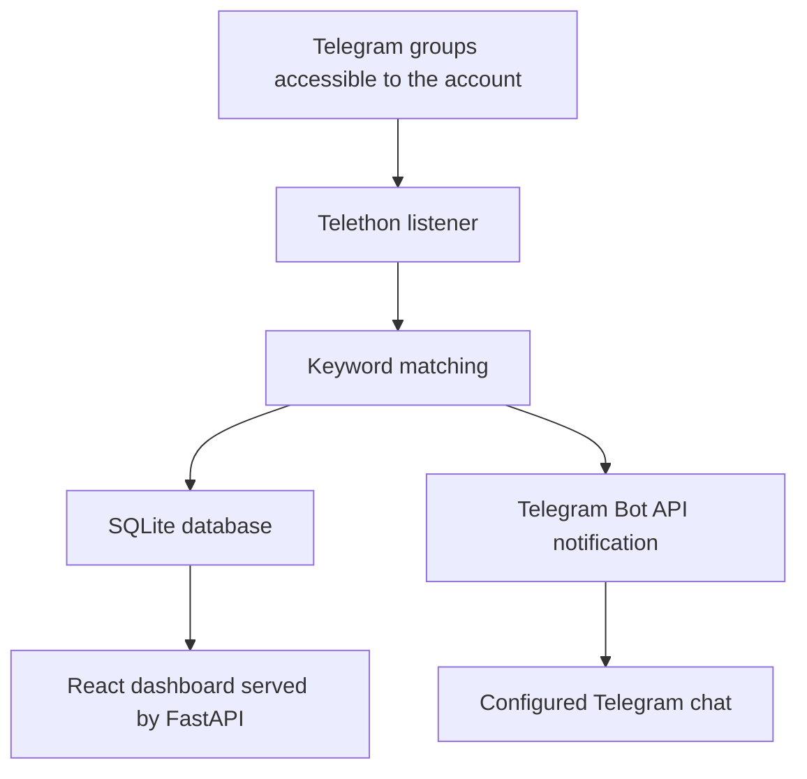

# Telegram Signal

**Find the Telegram messages that matter to you—without constantly checking every group.**

Telegram Signal is a keyword-monitoring dashboard designed to help people find relevant messages in busy Telegram groups. Configure keywords or phrases you care about, monitor Telegram groups your account is authorized to access, and review matching new messages in one place.

## The problem

Telegram groups can be useful sources of job openings, freelance projects, business leads, announcements, research discussions, and industry updates. But when information is spread across many busy groups, important posts can quickly disappear under unrelated messages. Checking every group manually takes time and makes it easy to miss something relevant.

## The solution

Telegram Signal monitors selected Telegram groups for configured keywords. When a new message matches, it records the match in a dashboard and can send a notification to a configured Telegram chat.

**The goal:** turn noisy Telegram activity into a more focused stream of information you want to review.

## Highlights

- **Keyword monitoring** — track words and phrases you choose.
- **Centralized results** — review matching messages in one dashboard.
- **Telegram notifications** — receive alerts in a configured Telegram chat.
- **Source context** — view available links to original messages.
- **Configurable sources** — monitor only groups your Telegram account can access and that you enable.

## Who might find it useful?

- **Job seekers** tracking vacancies and recruitment announcements
- **Freelancers** looking for project opportunities and potential clients
- **Entrepreneurs** following business leads and announcements
- **Researchers and professionals** tracking discussions and updates
- **Telegram power users** who follow many groups and want a more focused way to find relevant posts

## How it works

1. Choose Telegram groups or channels your account is authorized to access.
2. Add keywords or phrases you want to find.
3. Telegram Signal checks new incoming messages from enabled sources.
4. Matching messages are stored and shown in the dashboard.
5. Review the match and open the source message when a link is available.

## Product status

Telegram Signal is currently an **MVP (minimum viable product)**. The current implementation uses a React dashboard, FastAPI backend, Telethon user-account listener, Telegram Bot API notifications, and SQLite storage.

It is currently a single-user starter implementation—not yet a production-ready multi-user SaaS. Multi-user accounts, customer data isolation, subscription billing, and other production features need to be implemented and tested before offering the service broadly.

## High-level architecture

## What it does today—and what it doesn't

**Current MVP capabilities**
- Match new incoming text messages against configured keywords or phrases
- Display matches in a web dashboard
- Store group configuration, keyword rules, and matched messages in SQLite
- Send matching alerts to a configured Telegram chat

**Current limitations**
- Monitors new messages after the listener starts; it does not backfill historical messages
- Matching is case-insensitive literal keyword/phrase matching
- Media-only messages without text are ignored
- SQLite is intended for a single always-on instance; do not scale this implementation horizontally
- Advanced matching rules, multi-user authentication, account-level data isolation, and subscription billing are future work
- Telegram access, availability, and rate limits depend on Telegram and the permissions of the account being used

## Responsible use and privacy

Use Telegram Signal only with Telegram sources and content you are authorized to access. Respect group rules, Telegram's applicable terms, and the privacy expectations of group members. Do not use the product to bypass access controls.

The service may process message text, group identifiers, keywords, and matched-message metadata. A production service should clearly explain its data handling, retention, and deletion practices in its privacy policy.

## Support

For product questions or support, contact the developer through Telegram:

- **Telegram support:** [Add your Telegram username or support link here]

Replace the placeholder above with your actual support link before sharing this repository widely.

## Roadmap

- [ ] Harden authentication and session management
- [ ] Add secure multi-user accounts and strict customer data isolation
- [ ] Move production data to managed PostgreSQL
- [ ] Add subscription plans, usage limits, and verified payment handling
- [ ] Improve monitoring reliability, observability, and recovery
- [ ] Publish privacy policy, terms of service, and retention details
- [ ] Create a public demo and product screenshots

## Repository and intellectual property

This is a public product showcase. It describes Telegram Signal but does not include the proprietary application source code. The software implementation is maintained separately in a private repository.

Copyright © 2026 Faaiz Hamid. All rights reserved. Product names and third-party services mentioned here belong to their respective owners. This project is not affiliated with or endorsed by Telegram.

---

**Interested in trying Telegram Signal?** Contact the developer for beta access and availability.
