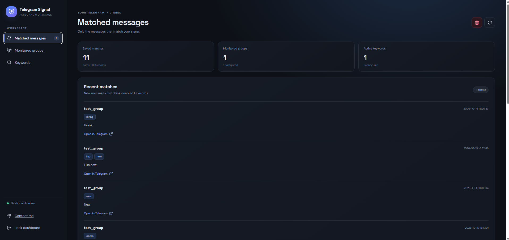
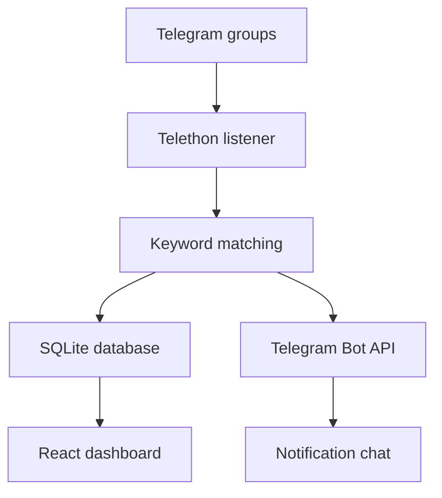

# Telegram Signal

**Find useful messages in Telegram groups without checking every group all day.**

Telegram Signal watches selected Telegram groups for keywords you set up. When a new message matches, it appears in the dashboard and can trigger a Telegram notification.

## Screenshots

## At a glance

- **Dashboard:** React
- **Backend:** FastAPI
- **Telegram listener:** Telethon
- **Notifications:** Telegram Bot API
- **Database:** SQLite
- **Current stage:** Single-user MVP. Multi-user SaaS features are still to be built.

## Why I built it

Telegram groups can be useful for finding job posts, freelance work, business leads, announcements, and industry news. The problem is that busy groups fill up quickly, and it's easy to miss a post tha[...]

Telegram Signal is meant to make that easier. Add the words or phrases you care about, select the groups you want to monitor, and check the matches in one place.

## Main features

- Monitor new messages for keywords and phrases
- See matching messages in a web dashboard
- Get alerts in a configured Telegram chat
- Open the original message when a link is available
- Choose which accessible groups to monitor

## How it works

1. Select Telegram groups or channels your account can access.
2. Add the keywords you want to track.
3. Telegram Signal checks new messages from those sources.
4. Matches are saved and shown in the dashboard.
5. If notifications are configured, a matching message can also trigger a Telegram alert.

## Current status

This is an MVP, not a finished multi-user SaaS product. The current version uses a React dashboard, a FastAPI backend, Telethon to listen to Telegram, the Telegram Bot API for alerts, and SQLite to st[...]

Before it can be offered as a reliable service to multiple customers, it still needs work on user accounts, keeping each customer's data separate, production hosting, billing, and operational monitori[...]

## How the parts fit together

## Current limitations

- It checks new messages after the listener starts; it does not search old messages.
- Keyword matching is case-insensitive and based on literal words or phrases.
- Messages with no text are ignored.
- The current SQLite setup is intended for a single running instance, not horizontal scaling.
- Multi-user accounts, customer data separation, subscriptions, and payments are not implemented yet.
- What the listener can see depends on the Telegram account's access and Telegram's own limits.

## Privacy and responsible use

Only monitor groups and messages you are allowed to access. Follow group rules and Telegram's applicable terms, and respect members' privacy.

A hosted version will need clear information about what data it stores, how long it keeps it, and how users can request deletion. Do not put real private messages, Telegram session files, bot tokens, [...]

## Roadmap

- [ ] Improve authentication and session security
- [ ] Add multi-user accounts and separate customer data
- [ ] Move production data to a managed database
- [ ] Add subscription plans and payment handling
- [ ] Improve logging, monitoring, and recovery
- [ ] Publish terms of service and a privacy policy
- [ ] Add a live demo

## Contact

For questions or beta access, contact me on Telegram.

<a href="https://t.me/whatashot07">💬 Message me on Telegram</a>

## About this repository

This is the public showcase for Telegram Signal. It explains the product but does not contain the application's proprietary source code, which is maintained in a separate private repository. This show[...]

Copyright (c) 2026 Faaiz Hamid. All rights reserved. Telegram and other third-party names belong to their respective owners. This project is not affiliated with or endorsed by Telegram.

---

The product is still in development. Features, availability, and pricing may change.
